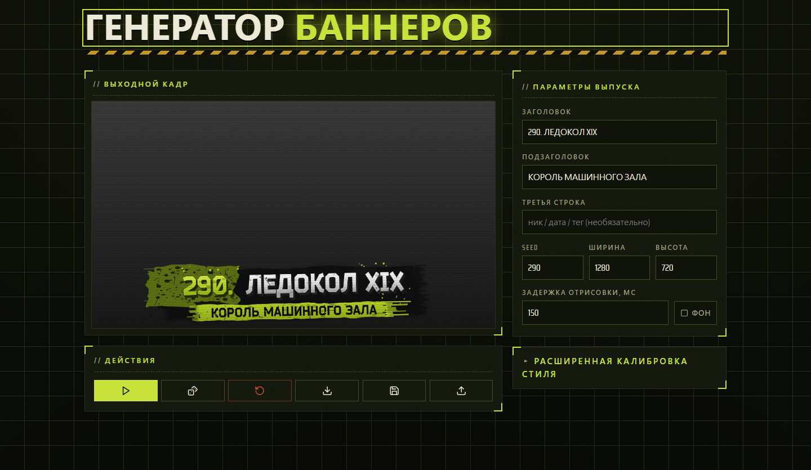
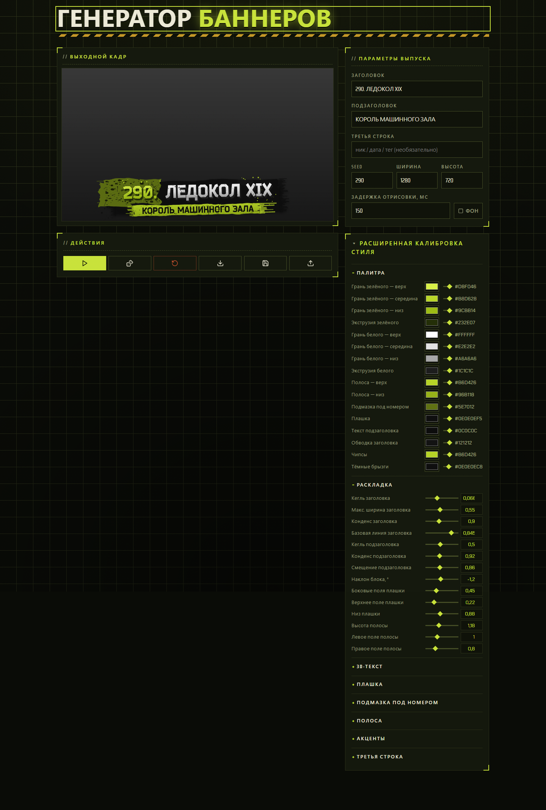

# Процедурный генератор баннеров

### Обложку для видео каждый раз просишь у ChatGPT – долго, платно и опять стиль уехал?

---

## Что это

Жирный номер выпуска зелёным, рваная плашка под ним, белый 3D-заголовок с экструзией, подзаголовок на
потрёпанной полосе, зелёная крошка и тёмные брызги по краям – узнаваемая обложка видео в стиле Тарькоф-превью.
Гонять такую через ChatGPT на каждый ролик – долго, стоит денег и каждый раз другой стиль: то шрифт уехал, то
плашка не та, то номер не там. Нейронка рисует «похоже», а надо **ровно так же**.

Этот генератор – замена той самой генерации обложки через ChatGPT. Никакой нейросети: чистая процедурная
отрисовка по твоим полям. Вводишь заголовок, подзаголовок, третью строку и seed – на выходе готовый PNG в
этом стиле. Вся фактура (потёртости, выгрызы, зерно, брызги, рваные края) **процедурная и детерминирована по
seed**: один и тот же seed – ровно та же картинка, сменил на соседний – тот же макет, но другой узор грязи. Не
легло – жмёшь 🎲 и крутишь, пока не понравится. Понравилось число – запомнил. Бесплатно, мгновенно, оффлайн\*.

\* Первый заход нужен онлайн – приложение грузится с GitHub Pages; дальше service worker держит его в
кэше и рисует без сети.

Под капотом – рендер-движок `BannerCore` на чистом SkiaSharp. Настраивать шаблоны можно как руками через
ползунки, так и подключив любого AI-агента (Claude Code, Codex, Cursor, Antigravity) напрямую к открытой
вкладке через MCP.

Весь рендер идёт **в браузере** на [SkiaSharp](https://github.com/mono/SkiaSharp) поверх Blazor WebAssembly.
Бэкенда нет, ничего никуда не уходит, хостится статикой на GitHub Pages. C#, .NET 10.

Открыть прямо сейчас, без
сборки – [thevsakeeper.github.io/procedural-banner-generator](https://thevsakeeper.github.io/procedural-banner-generator/).

---

## Скриншоты

Живой интерфейс на GitHub Pages: слева – кадр предпросмотра с готовым баннером, справа – поля выпуска и
действия.

Под «Расширенной калибровкой» – десятки ручек стиля (палитра, раскладка, 3D-текст, плашка, полоса, акценты,
третья строка): двигаешь ползунок – баннер перерисовывается на ходу.

Лучше [запусти и покрути сам](https://thevsakeeper.github.io/procedural-banner-generator/) – вживую.

---

## Что умеет

**Форма ввода**

Заголовок, подзаголовок, третья строка (ник / дата / тег – необязательно), seed, ширина и высота,
прозрачный фон. Рисует вживую по мере ввода, с настраиваемой задержкой отрисовки – чтобы не дёргалось на
каждой набранной букве.

**Рендер по seed**

Вся «случайность» завязана на seed: тот же seed – та же картинка, до пикселя. Кнопка 🎲 **Случайный вид**
кидает новое число и перерисовывает, не трогая текст. Нашёл удачный узор – seed это число, вернёшься к нему
когда угодно.

**Расширенная калибровка стиля**

Раскрываешь «Расширенную калибровку» – и под рукой десятки ручек: палитра (грани зелёного и белого, полоса,
плашка, обводка), раскладка (кегли, конденс, наклон блока, поля), 3D-текст (глубина экструзии, обводка,
зерно, выгрызы), плашка и подмазка под номером, полоса, акценты (чипсы, брызги, крошка), третья строка, обработка
фона (затемнение/блюр) и лого (угол, размер, прозрачность). Двигаешь ползунок – баннер тут же
перерисовывается.

**Свой фон и лого картинкой**

Кнопка **Фон картинкой** подкладывает под баннер свою картинку (скриншот игры вместо градиента-заглушки),
**Лого картинкой** ставит водяной знак в угол кадра. Картинка декодируется и рисуется **прямо в браузере**,
никуда не уходит; затемнение/блюр фона и угол/размер/прозрачность лого крутятся в «Расширенной калибровке».
Сами картинки в `localStorage` не сохраняются (тяжёлые) – после перезагрузки вкладки их нужно загрузить
заново, стиль при этом остаётся.

**Импорт и экспорт стиля**

Накрутил удачный вид – **Сохранить стиль** выгрузит его в JSON-файл. **Загрузить стиль** поднимет обратно:
переноси между машинами, держи коллекцию пресетов, откатывайся к прошлому.

**Скачать PNG**

Готовый баннер – картинкой, одной кнопкой. Без серверов и водяных знаков.

**Память**

Весь ввод и текущий стиль живут в `localStorage`: перезагрузил вкладку – всё на месте. Приватный режим или
очистка хранилища – тогда экспортни стиль в файл заранее.

---

## Редактирование и создание шаблонов через агентов (MCP)

На панели **Профиль стиля** нажми **Промпт для агента (MCP)** и вставь скопированный промпт в любого
агента (Claude Code, Codex, Cursor, Antigravity).

Что происходит дальше:
1. Агент уточняет, куда поставить мост (по умолчанию – в `./.banner-mcp/mcp-bridge.js` в рабочей директории агента) и нужно ли сохранять резервные JSON-копии профилей на диск, после чего одной командой скачивает автономный скрипт моста `mcp-bridge.js` (без внешних npm-зависимостей) и поднимает локальный мост на `127.0.0.1:5219`.
2. Открытая вкладка генератора автоматически подключается к мосту по WebSocket (индикатор меняется на
   **MCP: агент подключён**); параллельно в браузере регистрируются инструменты стандарта WebMCP
   (`navigator.modelContext`).
3. Агенту становятся доступны инструменты `list_templates`, `get_template`, `get_style_guide`,
   `create_template`, `update_template`, `undo_template`, `duplicate_template`, `rename_template`,
   `delete_template`, `set_active_template`, `reset_template_style`, `render_banner`.
4. При создании или частичной правке шаблона сайт тут же перерисовывает превью в браузере, записывает шаг
   в общую историю правок шаблона (её можно откатить кнопкой **Откатить** / в блоке **История шагов** на сайте
   или инструментом `undo_template` из агента), сохраняет шаблон в `localStorage` и возвращает агенту готовый
   PNG-кадр, чтобы агент видел результат своих правок.

---

## Чего не умеет

- Серверного бэкенда нет: весь рендер и хранение профилей идут прямо в браузере
- Это генератор баннеров в одном конкретном стиле, а не универсальный графический редактор

---

## FAQ

**Как открыть без сборки?**

[GitHub Pages](https://thevsakeeper.github.io/procedural-banner-generator/). Статика, ставить ничего не надо.

**Почему один seed всегда даёт одну и ту же картинку?**

Так задумано: вся «грязь» (брызги, потёртости, зерно, рваные края) детерминирована по seed. Хочешь другой
узор – меняй seed (🎲 Случайный вид) или крути сам. Композиция при этом держится, меняется только фактура.

**Можно править и создавать шаблоны текстом через LLM?**

Да, через MCP. Нажми **Промпт для агента (MCP)** в блоке «Профиль стиля» и отправь скопированный промпт
своему агенту. Агент подключится к открытой вкладке сайта и сможет создавать новые шаблоны, менять любые
ручки стиля и сразу видеть отрендеренный баннер.

**Стиль слетел после перезагрузки?**

Обычно он в `localStorage` и переживает перезагрузку. Если браузер в приватном режиме или хранилище почищено –
экспортни стиль в JSON заранее, через **Сохранить стиль**.

**Кнопки серые, баннер не рисуется?**

Ждёт шрифт. Пока `Bender-Black.otf` не загрузился, рендер заблокирован – это секунда.

---

*Обложка за пару кликов, а не за пять промптов.*
