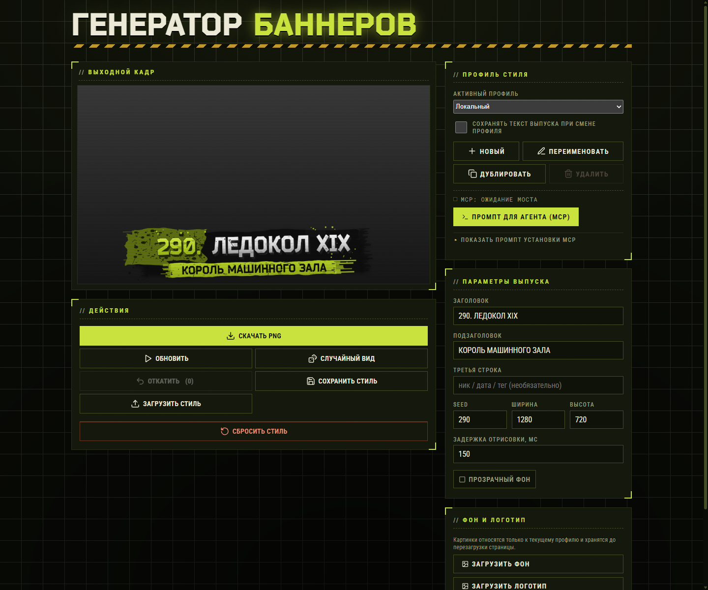
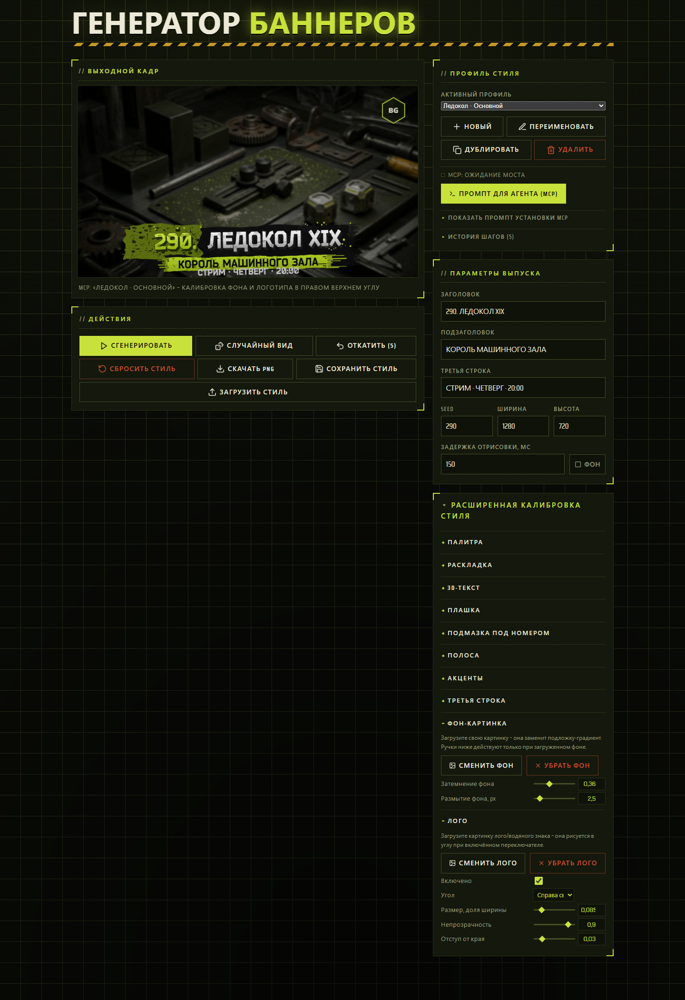
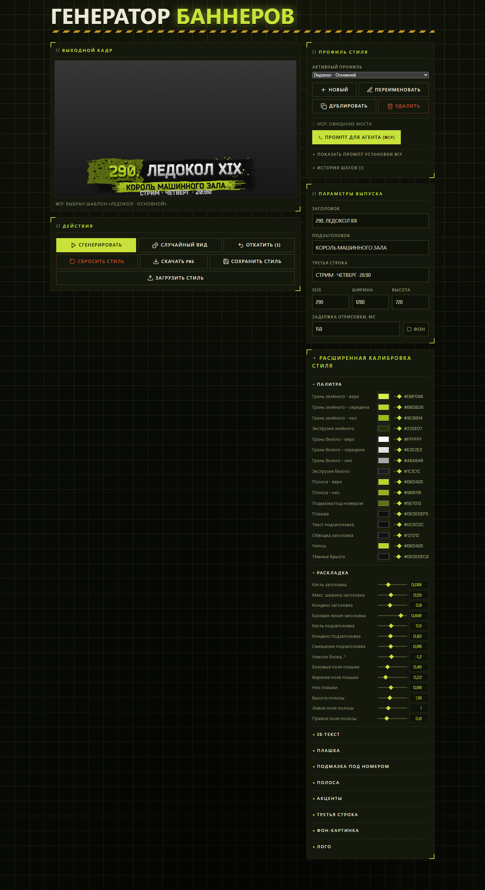
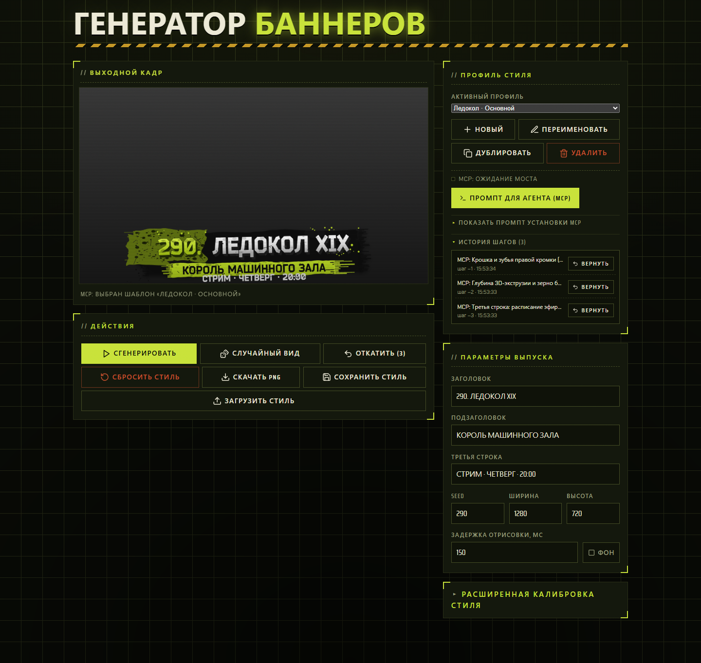
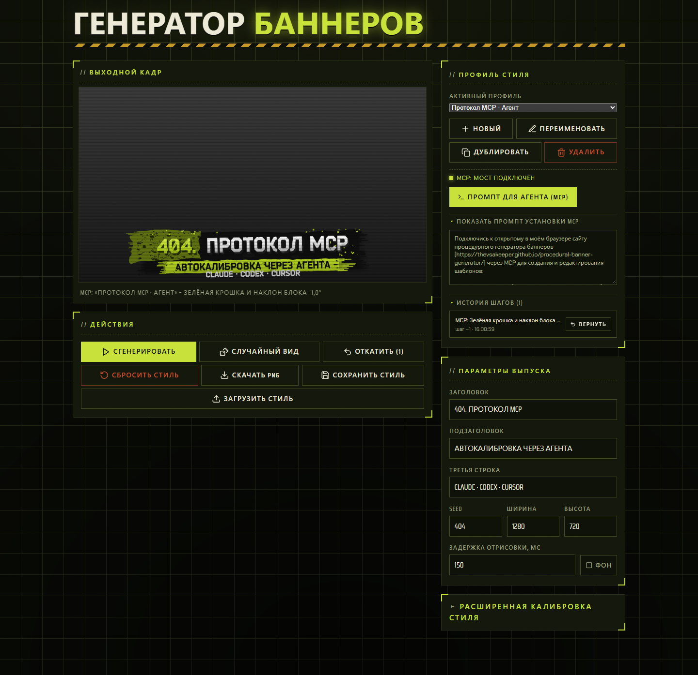

# Процедурный генератор баннеров


### Обложку для видео каждый раз просишь у ChatGPT – долго, платно и опять стиль уехал?

Жирный номер выпуска зелёным, рваная плашка под ним, белый 3D-заголовок с экструзией, подзаголовок на потрёпанной полосе
и крошка по краям – узнаваемая обложка в стиле Тарькоф-превью. Гонять такую через нейросеть на каждый ролик долго и
накладно, а главное – стиль постоянно плывёт: то шрифт чужой, то плашка съехала, то номер потерялся. Нейронка рисует
«похоже», когда нужно ровно так же, выпуск за выпуском.

Этот генератор заменяет ручную борьбу с промптами чистой процедурной отрисовкой на `SkiaSharp` прямо в браузере. Вводишь
заголовок, подзаголовок, третью строку и `seed` – и тут же получаешь готовый PNG в едином стиле. Вся фактура
(потёртости, выгрызы, зерно, брызги, сухие зубья краёв) детерминирована по `seed`: одно число даёт ту же картинку до
пикселя, соседнее – новый рисунок грязи при том же макете. Бонусом – профили с историей шагов, наложение своего фона и
логотипа и прямое подключение ИИ-агентов (Claude Code, Codex, Cursor, Antigravity) через MCP.

[](https://github.com/TheVSAKeeper/procedural-banner-generator/actions/workflows/deploy.yml)
[](https://thevsakeeper.github.io/procedural-banner-generator/)


**[Открыть генератор](https://thevsakeeper.github.io/procedural-banner-generator/)** · [Начать работу](#начать-работу) · [Руководство](GUIDE.md) · [Все скриншоты](assets/screenshots/README.md)



*Четыре режима работы (**Выпуск**, **Калибровка**, **Агент и MCP**, **Фокус**): под рукой остаётся только нужное под текущую задачу.
[Снимки предыдущей компоновки экрана](assets/screenshots/README.md).*

## Собрать обложку по seed за секунды

Заполняешь заголовок, подзаголовок и необязательную третью строку (расписание, ник или тег) – кадр перерисовывается на
ходу с настраиваемой задержкой, чтобы превью не дёргалось на каждой букве. Если заголовок начинается с номера и пробела
(`290. ЛЕДОКОЛ XIX`), движок сам выделяет номер контрастным градиентом и подкладывает под него рваную подмазку.



- **Точное повторение по `seed`**: кнопка **Случайный вид** перебирает новые числа `seed` от `1` до `999999`, меняя
  только узор брызг и сколов. Понравился узор – число `seed` вернёт его в любой момент.
- **Свой фон и водяной знак**: кнопка **Загрузить фон** доступна прямо в режиме **Выпуск**, а полный блок **Фон и логотип**
  (плюс наложение эмблемы в выбранный угол с затемнением и размытием) открывается в режиме **Калибровка**.
- **Прозрачный PNG и любые размеры**: в режиме **Калибровка** в блоке **Кадр и отрисовка** переключатель
  **Прозрачный фон** отдаёт чистый титр на прозрачном слое для видеоредактора в разрешении от `320 × 180` до `3840 × 2160`.

[Параметры выпуска, префикс номера, seed и экспорт PNG →](GUIDE.md#собрать-обложку-по-seed-за-секунды)

## Накрутить фактуру и палитру под канал

В режиме **Калибровка** на панели **Калибровка стиля** разложены 10 вкладок: от 16 цветов палитры и геометрии блока до
глубины 3D-экструзии, длины сухих зубьев на торцах плашки и количества осколков-чипсов.



- **Палитра и раскладка**: раздельные трёхточечные градиенты для зелёного номера и белых букв, цвет экструзии, обводки,
  полосы и подмазки, плюс кегли, конденс, автоужатие длинных заголовков и угол наклона всего блока (`-10°..+10°`).
- **Объём и гранж**: настройка глубины и наклона 3D-экструзии, толщины контура, плотности цветового зерна и выгрызов
  отдельно для букв, плашки, подмазки, полосы и третьей строки.
- **Живой отклик без перегрузки**: каждый ползунок и выбор цвета сразу перерисовывает `SkiaSharp`-холст с учётом
  заданной задержки отрисовки (`0..3000 мс`).

[Палитра, 3D-экструзия, рваные плашки, фон-картинка и логотип →](GUIDE.md#накрутить-фактуру-и-палитру-под-канал)

## Держать профили и откатывать шаги

Выбор активного профиля всегда под рукой в верхней панели, а кнопка **Профиль** раскрывает **Управление профилями**,
чтобы вести пресеты под разные рубрики, дублировать удачные варианты и не портить настроенный вид во время экспериментов.



- **Независимые профили в `localStorage`**: создавай новые профили с нуля, клонируй существующие кнопкой **Дублировать**
  и переключайся между ними из выпадающего списка.
- **История на 20 шагов со склейкой**: каждый профиль помнит до 20 последних изменений; быстрые движения ползунков в
  пределах 1,5 секунды склеиваются в один осмысленный шаг с перечислением затронутых секций, а список **История шагов**
  всегда открыт в режиме **Агент и MCP** и свёрнут в **Калибровке**.
- **Импорт и экспорт JSON**: кнопка **Сохранить стиль** в режиме **Калибровка** выгружает декларативный `banner-style.json`,
  который легко перенести на другую машину или положить в репозиторий.

[Профили в браузере, история на 20 шагов и перенос JSON →](GUIDE.md#держать-профили-и-откатывать-шаги)

## Поручить настройку стиля ИИ-агенту по MCP

Вместо ручного подбора десятков ползунков можно открыть вкладку **Агент и MCP** (или кликнуть индикатор MCP в верхней
панели), нажать **Промпт для агента (MCP)** и отправить скопированную инструкцию в Claude Code, Codex, Cursor или
Antigravity – агент сам подключится к открытой вкладке браузера.



Локальный скрипт моста `mcp-bridge.js` работает без внешних npm-зависимостей, поднимает сервер на `127.0.0.1:5219` (HTTP
`/mcp`, `stdio` и CLI-вызовы) и открывает агенту 12 инструментов (`list_templates`, `get_style_guide`,
`create_template`, `update_template`, `undo_template`, `render_banner` и др.). После каждой правки сайт перерисовывает
баннер, пишет шаг в общую историю профиля и возвращает агенту готовый PNG-кадр для визуальной самопроверки.

[Подключение Claude Code, Codex и Cursor, инструменты MCP и работа офлайн →](GUIDE.md#поручить-настройку-стиля-ии-агенту-по-mcp)

## Начать работу

1. Открой [веб-приложение на GitHub Pages](https://thevsakeeper.github.io/procedural-banner-generator/) – установка не
   требуется, после первой загрузки service worker кэширует приложение и шрифт `Bender-Black.otf` для работы без
   интернета. Локальные кириллические шрифты интерфейса также входят в офлайн-кэш.
2. В режиме **Выпуск** введи свой заголовок, подзаголовок и при необходимости третью строку в блоке **Параметры выпуска**,
   затем понажимай **Случайный вид**, чтобы выбрать удачный узор потёртостей.
3. Подкрути палитру и фактуру на вкладках режима **Калибровка**, подключи ИИ-агента во вкладке **Агент и MCP** или включи
   **Фокус** для работы с полноширинным превью, после чего скачай готовый кадр кнопкой **Скачать PNG**.

Все профили, текст и история шагов сохраняются в `localStorage` браузера (`banner-profiles-v1`). Для переноса между
браузерами используй **Сохранить стиль** (`banner-style.json`): файл содержит оформление без текста и истории.
Для полной резервной копии сохрани значение `banner-profiles-v1` из localStorage или выгрузи шаблоны через MCP.

## Как приложение обращается с данными

| Ситуация                                             | Что происходит                                                                                                    |
|------------------------------------------------------|-------------------------------------------------------------------------------------------------------------------|
| Отрисовка баннера и экспорт PNG                      | Выполняется локально в браузере через WebAssembly и `SkiaSharp`; серверного бэкенда нет.                          |
| Загрузка своей картинки фона или логотипа            | Файл декодируется в памяти вкладки и никуда не отправляется; в `localStorage` тяжёлые картинки не пишутся.        |
| Перезагрузка вкладки или закрытие браузера           | Все профили, поля текста и история до 20 шагов восстанавливаются из `localStorage`.                               |
| Случайный сдвиг ползунка или неудачная правка агента | Отменяется кнопкой **Откатить**, выбором точки в **Истории шагов** или вызовом `undo_template` по MCP.            |
| Подключение ИИ-агента через MCP                      | Мост слушает только локальный адрес `127.0.0.1:5219` на твоей машине и общается с открытой вкладкой по WebSocket. |

Генератор не использует внешние облачные API, телеметрию и учётные записи.
[Подробные правила и частые вопросы →](GUIDE.md#частые-вопросы)

## Собрать из исходников

Нужен .NET 10 SDK (`10.0.100` или новее) с workload для WebAssembly (`dotnet workload restore ProceduralBannerGenerator/ProceduralBannerGenerator.csproj`
подтянет `wasm-tools` на .NET 10 или `wasm-tools-net10` на .NET 11).
Нативная WASM-сборка включена в проекте для SkiaSharp; после смены его версии выполните `dotnet build -t:Rebuild`,
чтобы исключить старые WebCIL-артефакты в локальном выводе. Ядро рендера выделено в библиотеку `BannerCore`, веб-интерфейс – проект Blazor
WebAssembly в папке `ProceduralBannerGenerator`.

```powershell
dotnet run --project ProceduralBannerGenerator
```

Проверка сборки решения (`BannerCore` + `ProceduralBannerGenerator`):

```powershell
dotnet build ProceduralBannerGenerator.slnx -c Release
```

---

[Подробное руководство](GUIDE.md) · [Галерея всех экранов](assets/screenshots/README.md) · [Паспорт иллюстраций](assets/readme/README.md) · [Сообщить о проблеме](https://github.com/TheVSAKeeper/procedural-banner-generator/issues)

*Обложка за пару кликов, а не за пять промптов.*
